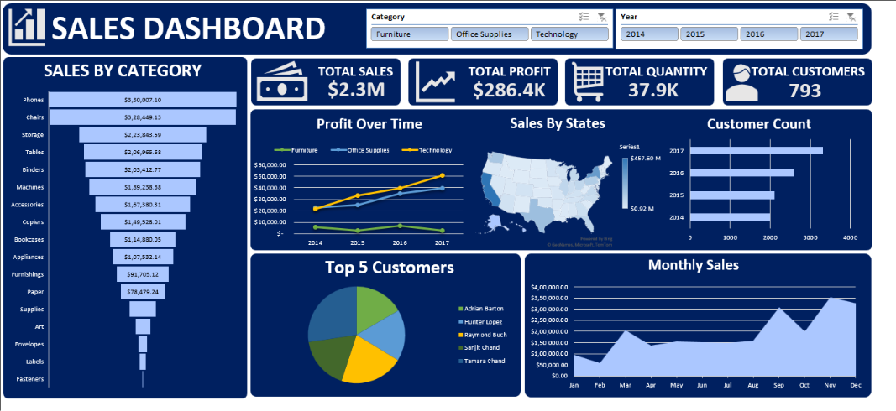

# Sales Dashboard (Excel)

An interactive sales dashboard built in Microsoft Excel using PivotTables, PivotCharts, a map chart and slicers. It summarises about 10,000 retail orders from 2014 to 2017 by category, state, customer and time.

## Key figures (all data)

| Total Sales | Total Profit | Total Quantity | Total Customers |
|-------------|--------------|----------------|-----------------|
| $2.3M | $286.4K | 37.9K | 793 |

## What's inside

| File | Description |
|------|-------------|
| `SalesDashboard.xlsx` | The dashboard workbook (data sheet, pivot sheets, final dashboard sheet) |
| `salesdata.csv` | Raw order data (~9,990 rows) |
| `dashboard.png` | Screenshot of the finished dashboard |

**Data columns:** Order Date, Customer Name, State, Category, Sub-Category, Product Name, Sales, Quantity, Profit

## Dashboard contents

- KPI cards: total sales, profit, quantity, customers
- Sales by Category / Sub-Category (funnel chart)
- Profit over time by category
- Sales by State (map chart)
- Customer count by year
- Top 5 Customers
- Monthly Sales
- Slicers for Category and Year

## How to use

1. Download or clone this repo.
2. Open `SalesDashboard.xlsx` in Microsoft Excel (desktop version recommended; slicers and map charts don't fully work in Google Sheets or LibreOffice).
3. Use the Category and Year slicers on the dashboard sheet to filter.
4. If you update the data, refresh the pivots: **Data > Refresh All**.

## Skills demonstrated

Data cleaning, PivotTables, PivotCharts, slicers, KPI design, dashboard layout.

## Author

Sam, B.E. AI & Data Science
